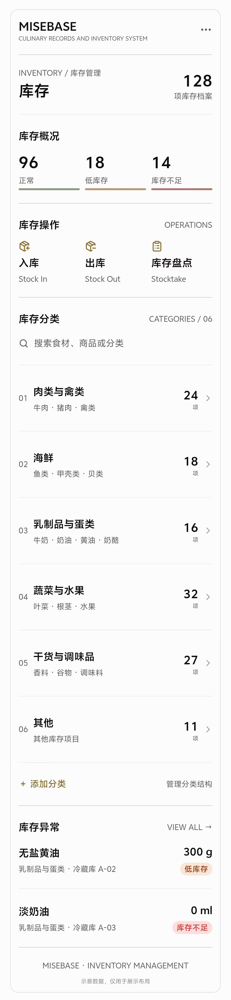
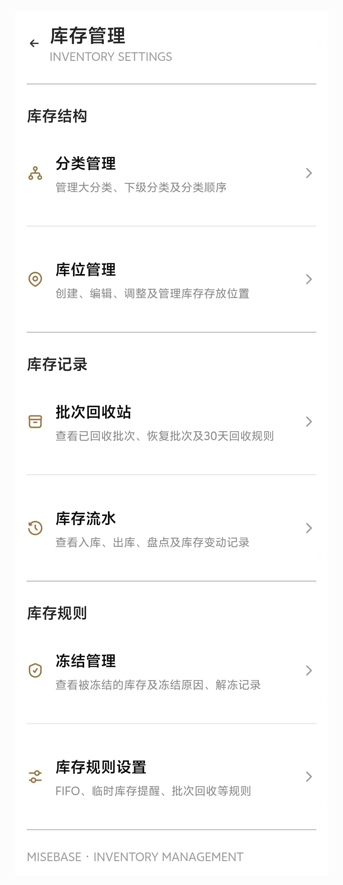
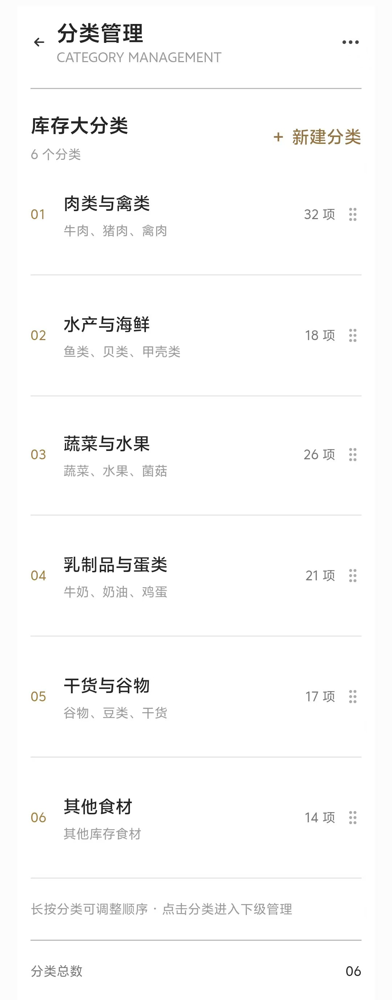
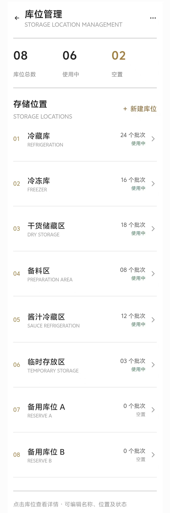
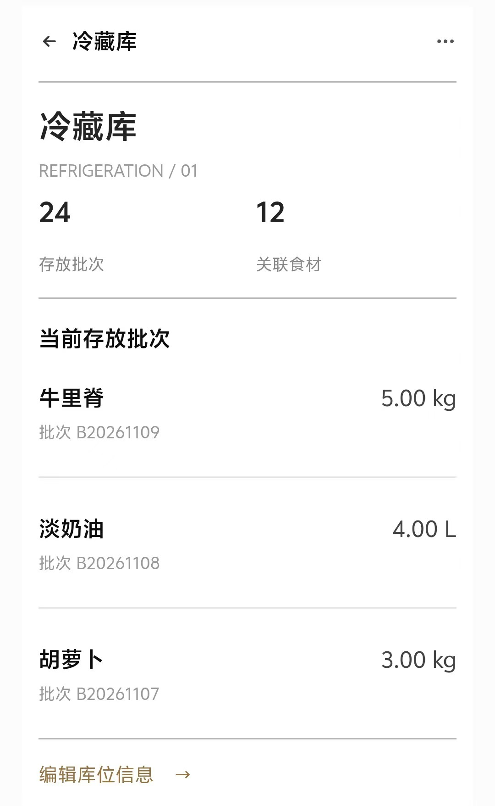
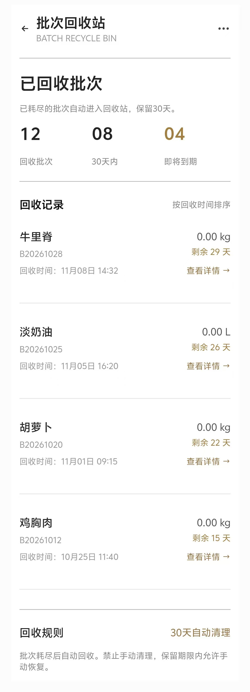
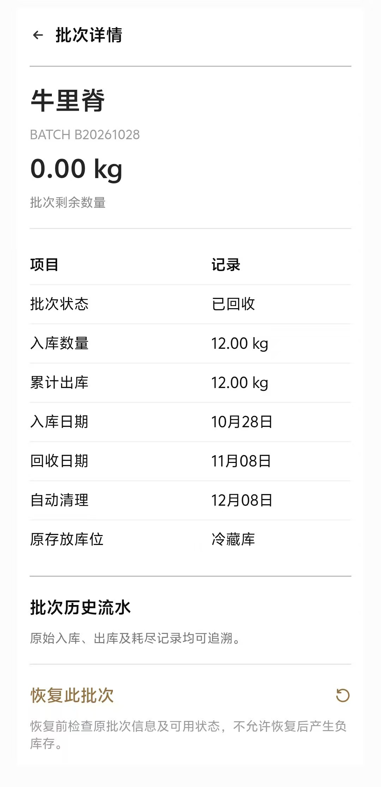

# MISEBASE-DESIGN-REFERENCE
MISEBASE UI Design and Workflow References

## 以下是库存的主页详情UI

## 针对右上角可以点击的"ooo"，点击之后会进入库存管理,呈现以下状态：

## 然后再往下，就是各个抽屉所代表进入的界面

## 分类管理的样子(左上角的三点没有作用，只是生成时候的遗留):

## 点击新建大分类，默认会弹出一个新建分类的弹窗，长按大分类，可以抓住大分类，然后上下滑动排序

## 库位管理的样子:

## 随机点击“冷藏库”的话，会进入下面的界面(左上角的三点没有作用，只是生成时候的遗留):

## 现在回到库存管理，点击“批次回收站”，会进入以下界面(左上角的三点没有作用，只是生成时候的遗留)：

## 然后再点击详细的，比如说牛里脊的话，它会进入以下界面:

